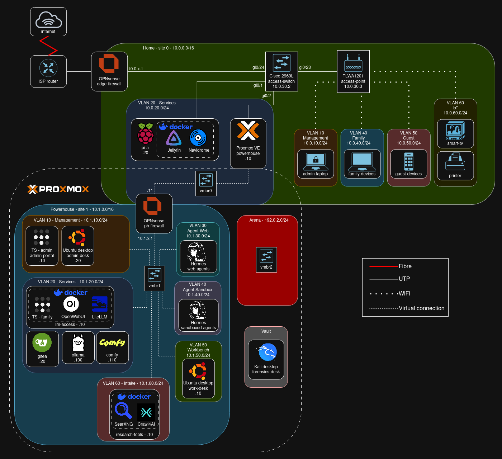

# Leo's homelab

Welcome to my homelab repo! Here you'll find notes and configurations for my applications, services and the networks they run on. This repo documents the build as it progresses.

I'm building this homelab for two reasons:
- *To stop paying for subscriptions* - I run my own LLMs, streaming and git services locally and privately.
- *To learn real networking* - everything sits on VLANs behind a real firewall.

## Current setup
- Lenovo desktop PC running Opensense, acting as my edge firewall and inter-VLAN router for my home network
- Cisco Catalyst 2960L switch with a TP-link TLWA1201 access point
- Raspberry Pi running streaming services
- One Proxmox node built for running LLMs, with its own firewalled network:
    - OPNsense VM routing between VLANs and enforcing firewall rules
    - Ollama and ComfyUI VMs with GPU passthrough for running LLMs and diffusion models
    - Private OpenWebUI, LiteLLM and Gitea services
    - A SearXNG/Crawl4AI box giving agents and OpenWebUI web access
    - Hermes agent backends

## Network plan

## Directory index

| Doc | What it covers |
| --- | --- |
| [network/](network/) | sites, addressing and VLAN plan |
| [network/opnsense.md](network/opnsense.md) | firewall roles and rule sets |
| [network/remote-access.md](network/remote-access.md) | Tailscale, subnet routers |
| [services/ollama.md](services/ollama.md) | LLM inference on 4x V100s |

## My next steps

- Two more Proxmox nodes planned:
    - a storage box to run TrueNAS, and my Gitea service
    - a box for public-facing web services
